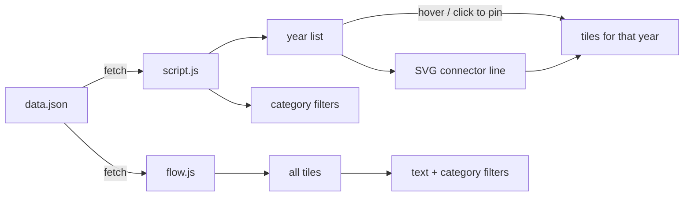

# How the timeline is built

A static site: two HTML pages, two stylesheets, two scripts and one JSON data file. No framework, no bundler, no
runtime dependencies. It began as a project to try Cursor and was later extended with Claude Code; the code is
deliberately simple and the look (NES palette, Press Start 2P) is kept as it was.

## Runtime

| Piece | What it uses |
|---|---|
| Data | `data.json`, fetched once: 1,012 items across 1950–2025, in ten categories |
| Photos | 759 hotlinked from Wikimedia Commons (each with a credit), 67 local files kept small, 186 without |
| Connector line | An SVG polyline from the selected year's bullet to its tiles, recomputed from element positions |
| Fonts | Press Start 2P from Google Fonts |
| Libraries | None at runtime |

Dev only: Node's built-in test runner (data checks), Playwright + axe-core (browser and accessibility tests).
Python (`download_images.py`, with `requests`) and a shell script were used once to fetch local images.

## Files

```
index.html, script.js, style.css   the timeline: years down the side, that year's tiles beside them
flow.html, flow.js, flow.css       the flow view: every tile in one scrolling wall, with text and category filters
data.json                          { "YYYY": [ { year, category, caption, photo, credit? } ] }
images/<year>/                     local photos (≤ 0.1 megapixels, fair-use size)
download_images.py, fixed_dl_images.sh   one-time image fetching
tests/data.test.js                 data checks
e2e/                               Playwright: timeline flows, smoke, axe
```

## How it fits together



## Core techniques

- **Data-driven, rebuilt on change.** Both pages fetch `data.json` and build the DOM from it; filters rebuild the
  visible tiles rather than hiding nodes.
- **Hover with a pinned year.** Hovering a year previews its tiles; clicking pins it. The script tracks whether the
  pointer is over the list or the tiles so moving between them doesn't flicker.
- **Connector.** The line between a year and its tiles is an SVG polyline computed from `getBoundingClientRect`
  of the bullet and the tile area, redrawn each time a year is shown.
- **Images within fair use.** Remote photos come only from Wikimedia, each with a credit and link; local copies
  are capped at 0.1 megapixels.

## Testing and deploy

- `npm test` (Node's test runner) checks the data: every year 1950–2025 has at least five items, including
  music, TV, film and news; known categories; no duplicate captions in a year; every remote photo has a credit;
  local images exist and are under the size cap.
- `npm run test:e2e`: Playwright at desktop and phone size (Wikimedia and fonts blocked so tests don't depend on
  the network), with axe accessibility checks.
- Pushing to `main` runs both in GitHub Actions (the shared workflow in
  [csciuto/app-template](https://github.com/csciuto/app-template)); only if they pass are both pages stamped with
  a version and published to GitHub Pages.

## Known limits

- Hotlinked photos depend on Wikimedia staying up and keeping the files.
- The view isn't in the URL, so a pinned year can't be shared as a link.
- The connector isn't redrawn when the window is resized until another year is shown.
- Scope is American pop culture and news; the selection is editorial.
