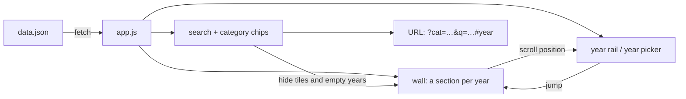

# How the timeline is built

A static site: one page, one stylesheet, one script and one JSON data file. No framework, no bundler, no runtime
dependencies. It began as a project to try Cursor, as a timeline of the author's own lifetime (from 1983), and was
later extended with Claude Code. The look (NES/SNES grays and purple, Press Start 2P) is deliberate and kept.

## Runtime

| Piece | What it uses |
|---|---|
| Data | `data.json`, fetched once: 1,042 items across 1950–2025, in 14 categories |
| Photos | 1,042 local files kept small (981 copied from Wikimedia, each with a credit); every item has one |
| Fonts | Press Start 2P from Google Fonts |
| Libraries | None at runtime |

Dev only: Node's built-in test runner (data checks), Playwright + axe-core (browser and accessibility tests).
Python with Pillow (`tools/localize_images.py`) copies and shrinks photos into `images/`.

## Files

```
index.html, app.js, style.css     the timeline: every tile in one wall, grouped by year
flow.html                          redirect from the old flow view's address
data.json                          { "YYYY": [ { year, category, caption, photo, credit? } ] }
images/<year>/                     local photos (≤ 0.1 megapixels, fair-use size)
tools/localize_images.py           copies a photo given as a URL into images/, shrunk
download_images.py, fixed_dl_images.sh   older one-time fetchers (don't shrink)
tests/data.test.js                 data checks
e2e/                               Playwright: timeline flows, smoke, axe
```

## How it fits together



## Core techniques

- **Built once, filtered by hiding.** The page builds every tile from `data.json` once; filters set `hidden` on
  tiles and on years left empty, so images already loaded stay loaded. Images load lazily as they scroll near.
- **Years.** Each year is a `<section id="YYYY">` with a sticky heading. A rail of years by decade (wide screens) or
  a year picker (under 760px) jumps to a year; the year at the top of the wall is highlighted in both, from the
  scroll position. A jump near the end of a filtered wall keeps the chosen year highlighted until you scroll.
- **Filters.** Search matches captions. Category chips: none chosen shows everything; each chip adds its category.
  When filters change, the wall stays on the year you were reading (or the next year with matches).
- **State in the URL.** `?cat=Art,Books&q=moon#1983`, written with `history.replaceState`, so a link reopens the
  same view. The old `flow.html` address redirects here, keeping its hash.
- **Sticky offsets.** The header's height (it wraps differently by width) is measured into `--top-h`, which the
  rail, the year headings and `scroll-padding-top` use.
- **Images are local and within fair use.** Every photo is a file in `images/`, capped at 0.1 megapixels; those
  copied from Wikimedia keep a credit and a link to the source page. `tools/localize_images.py` copies and
  shrinks a photo given as a URL.

## Testing and deploy

- `npm test` (Node's test runner) checks the data: every year 1950–2025 has at least five items, including
  music, TV, film and news; known categories; no event listed twice (reworded in one year, or again within three years); one music tile per artist per year; every photo is a local file that
  exists and is under the size cap; credits link to a source.
- `npm run test:e2e`: Playwright at desktop and phone size (fonts blocked so tests don't depend on the
  network), with axe accessibility checks.
- Pushing to `main` runs both in GitHub Actions (the shared workflow in
  [csciuto/app-template](https://github.com/csciuto/app-template)); only if they pass is the page stamped with
  a version and published to GitHub Pages.

## Known limits

- Scope is American pop culture and news; the selection is editorial.
